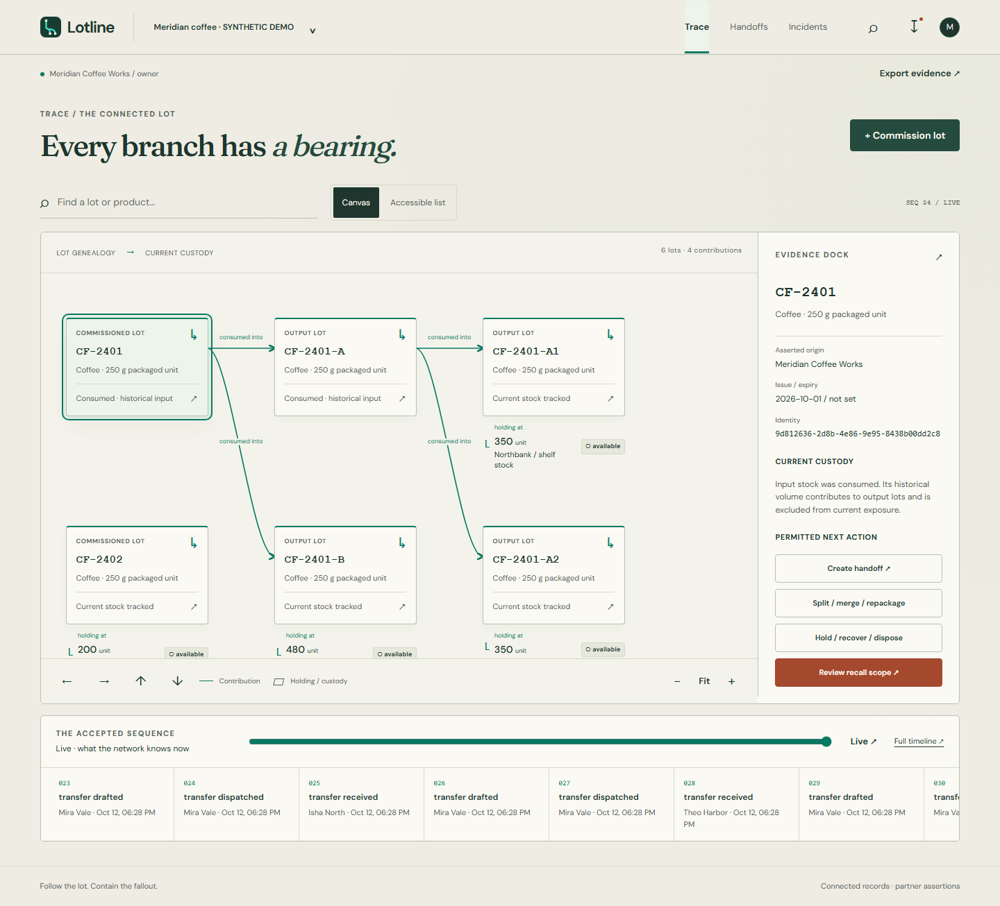

# Lotline

**Follow the lot. Contain the fallout.**

Lotline is an operational traceability and recall workbench for a small manufacturer and its warehouse / retail partners. Commission stock, preserve batch contribution paths, obtain independent receipts, contain affected stock, and close an incident only after responses and quantity accounting.



The public entry now has an original paper-character cast, a skippable cinematic opening, a spatial coffee scene and continuous-thread page transitions. [Design references and interactions](docs/frontend-direction.md), [desktop story](docs/screenshots/story-1440.png), [opening frame](docs/screenshots/opening-1440.png), [phone story](docs/screenshots/story-360.png). Reduced motion retains every workflow.

## What works

- Owner-created workspace, cooperating organizations, sites, bounded operator / partner / auditor grants, and expiring invitations.
- Exact decimal commissioning, partial consumption, split / merge / repackage into newly identified output lots, and explicit declared loss.
- Draft / reservation / dispatch, receiver-only acceptance, short receipts with unresolved remainders, returns and accountable loss resolutions.
- Versioned recall preview, conservative mixed-lot exposure, synchronous holds, independent acknowledgment and recovery, overlapping incidents, late correction / reopening, and justified closure.
- Journal-derived historical sequences, private partner scope, internal leased notifications, printable evidence exports and local hash verification.

The connected coffee case starts with 1,200 units. Its descendant holdings total 1,180 received units, with 20 unresolved; 200 unrelated units stay outside known scope. Historical parents are never added to current children as extra stock.

## Start from a fresh clone

Public demo: **https://supplyledger.vercel.app/**. [Short usage guide and practical examples](docs/using-lotline.md).

On Windows with Docker Desktop running and Node 22 installed, start everything with:

```powershell
.\scripts\start-local.ps1
```

This generates private local credentials if needed and serves the app at **http://127.0.0.1:4173**. Create your own workspace account. Stop it with `.\scripts\stop-local.ps1`; database records are retained. Stop any earlier frontend for this checkout before launching.

Requirements: Docker with Linux containers; Node 22 (local / CI pin **22.17.0**, npm **10.9.2**); Java **21.0.9** for native backend development; Python **3.14.6** for verification utilities. Docker includes the Java runtime and pinned Maven **3.9.16** wrapper.

1. Copy `.env.example` to `.env`. Replace `DB_PASSWORD`, `JWT_SECRET` (random 32+ characters), and `DEMO_PASSWORD` (12+ characters). These are local choices, never built-in owner credentials.
2. Run the API and PostgreSQL:

   ```sh
   docker compose up --build -d
   ```

3. Start the frontend in a separate terminal:

   ```sh
   cd frontend
   npm ci
   npm run dev
   ```

4. Open **http://localhost:5173**. Create a workspace, open its menu to add a site / product, and commission the first lot. Copy an invitation link so a second account can independently receive stock and respond to incidents.

Readiness: **http://localhost:8080/actuator/health/readiness**. Health details are intentionally minimal. Durable local data resides in the PostgreSQL named volume; application restarts preserve it.

For a native backend, export the variables from `.env`, start only `docker compose up db -d`, then `cd backend` and run `./mvnw spring-boot:run` (`.\mvnw.cmd` on Windows). `DB_HOST=localhost`, `DB_PORT=5433`. The frontend proxy keeps all browser API calls at `/api/v1`.

## Synthetic demo and verification

Set `DEMO_PASSWORD` explicitly in your terminal; the scripts do not read or seed production automatically.

```sh
python scripts/seed-demo.py --prefix lotline-demo
python scripts/smoke.py --output artifacts/smoke
python scripts/verify-evidence.py artifacts/smoke/lotline-evidence.zip
```

The first script leaves the coffee case ready for recall preview. Sign in as `lotline-demo+owner@example.test` or `lotline-demo+partner1@example.test` through `partner4`, using your chosen `DEMO_PASSWORD`. Smoke uses a separate unique workspace and completes containment / closure / export. See [demo instructions](docs/demo.md).

```sh
cd backend
./mvnw -B -ntp verify
cd ../frontend
npm ci
npm run typecheck
npm run lint
npm run format:check
npm test
npm run build
npm run test:e2e
```

PostgreSQL Testcontainers requires Docker. E2E requires a real API/database at `localhost:8080`, a seeded `lotline-demo` workspace, `DEMO_PASSWORD`, and `npx playwright install chromium`. Playwright starts the production frontend preview at port 4173; it never substitutes mock workspace data. [Executed results and measured limits](docs/verification.md) distinguish local verification from deployment.

## Architecture and deployment

One Java 21 Spring Boot application, JDBC domain services, plain PostgreSQL, an append-only accepted journal, derived balances, and a bounded internal outbox. Vite / TypeScript / React Router / TanStack Query provide the daily workbench. The original public SVG scenes render immediately and load GSAP / ScrollTrigger separately for optional animation. Page transitions use the native Web Animations API. Device and manual reduced-motion preferences retain the complete static presentation. Fonts are self-hosted, with OFL licenses in `frontend/public`.

| Read | Purpose |
|---|---|
| [Architecture](docs/architecture.md) | Domain vocabulary, transaction guard, quantities, history, scope |
| [API](docs/api.md) / [OpenAPI](docs/openapi.json) | Commands, decimal DTOs, stable errors, bounds |
| [Security](docs/security.md) | Session rotation, site grants, runtime database permissions |
| [Deployment](docs/deployment.md) | Render first, concrete Vercel rewrite, secrets, backups, cutover |
| [Implementation notes](docs/implementation-notes.md) | Starting commit, preserved local work, keep/delete decisions |

`render.yaml` defaults to a **temporary synthetic demo**. Durable always-on service / database selections require the owner’s billing decision. The authoritative `frontend/vercel.json` targets the existing Render API:

```sh
node scripts/configure-vercel.mjs https://YOUR-ACTUAL-API.onrender.com
python scripts/check-deployment.py
```

The existing provider projects are being cut over to this implementation. Executed public deployment checks and temporary hosting limits are recorded in [deployment.md](docs/deployment.md).

## Product limits

Lotline records partner assertions and enforces its connected command paths. It does not physically verify counts, stop vehicles, or discover unreported events. Unknown custody can be recorded as a visible evidence gap. An export hash verifies snapshot bytes, not physical authenticity or an external trust anchor.

Transformations keep the **same product and base unit**. A recall groups roots with the same base unit. No inferred kg-to-piece yield, external carrier / email service, binary attachment store, ERP, billing, or physical authenticity classifier is included. Graphs / exports are bounded and return an explicit incomplete or blocked result. Legacy `public` data is left untouched; its images or vectors are not converted into genealogy.
